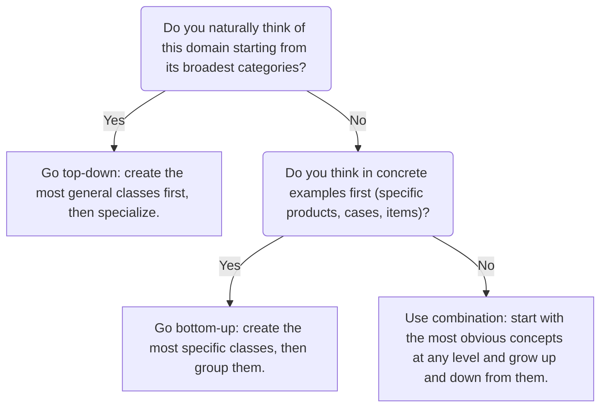
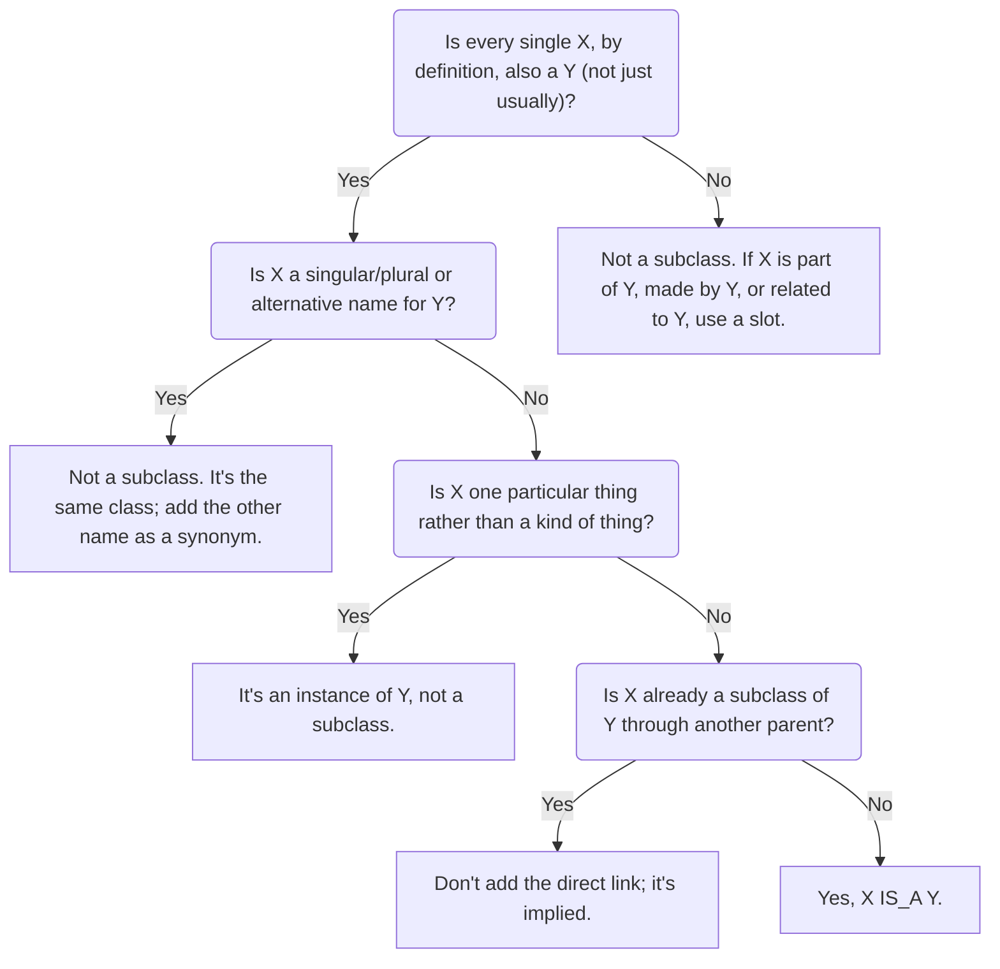
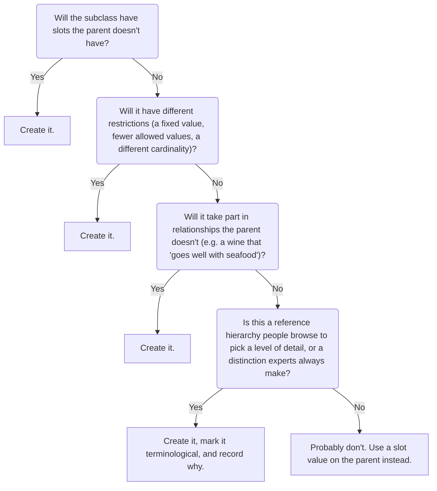
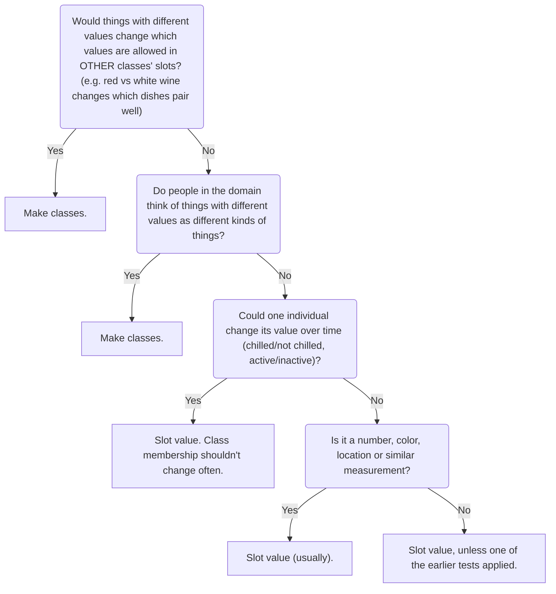
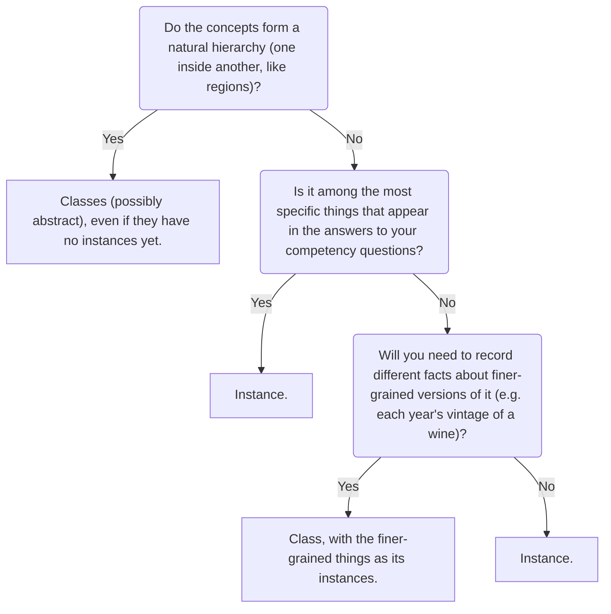
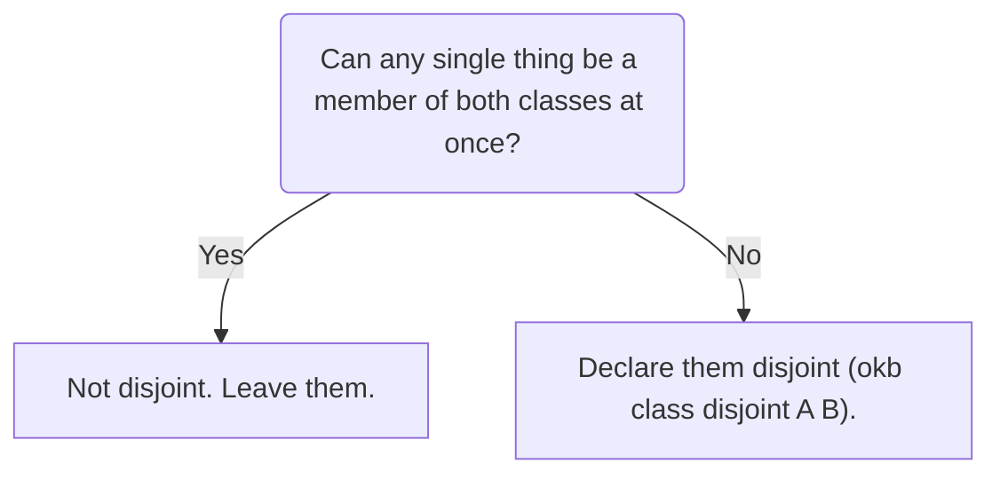
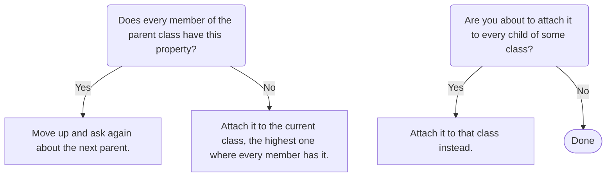
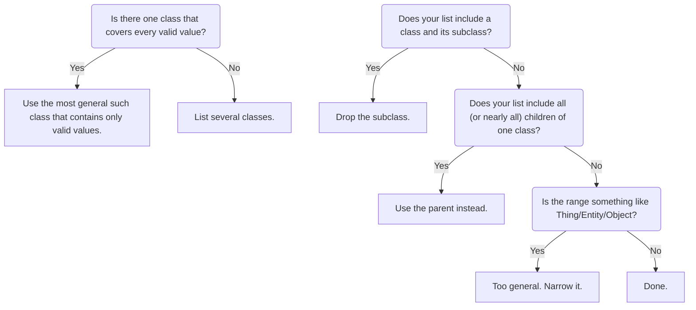
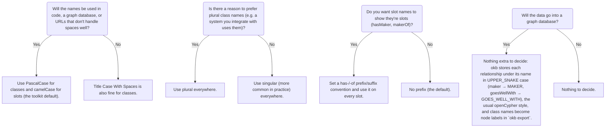
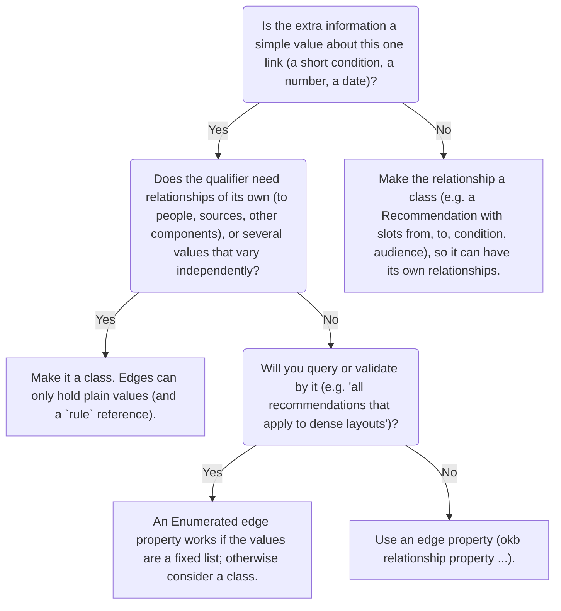

# Decision guides

<!-- Generated from the meta-KB (v2.6.0) by `pnpm run docs`. Don't edit by hand: change `packages/okb/meta-kb/src/*.yaml` and regenerate. -->

## What decision guides are

Building an ontology means making choices. Is this a class or one particular thing? Should I split this class in two? Where does this property belong? There is rarely one right answer.

Making decisions about your ontology can be hard, and that's why Ontology Kit provides guides to help you arrive at good decisions. Each one is a short series of yes or no questions that walks you to a sensible choice.

## How to use a guide

1. Find the guide that matches what you are deciding. The list on the right, under *The guides*, shows them all.
2. Answer the first question. Each answer either gives you your choice or sends you to the next question.
3. Read the guide as a flowchart or as a list of steps, whichever is easier for you. The toggle above each guide switches between them.

## Record what you decided

A guide helps you choose. It doesn't save your choice. When you have decided, write it down with `okb decision add`, along with why. That way you, and anyone who reads your ontology later, can see the reasoning. A recorded decision can also explain why you broke a SHOULD rule on purpose: add `--waives <rule>` and the warning is marked as explained. See [Rules](RULES.md) for which rules allow that, and [Design decision](GLOSSARY.md#concept-design-decision) in the glossary.

## The guides

<section class="decision">

### Top-down, bottom-up, or combination?

Before you add your first class, decide where to start: with the big general categories, with specific examples, or somewhere in the middle. None of these is wrong. This guide helps you find the one that fits how you think about your subject.

> **Good to know.** None of the three is better than the others. Combination is often the easiest for beginners, because the middle-level concepts tend to be the most descriptive.

1. **Do you naturally think of this domain starting from its broadest categories?**
   - **Yes:** Go top-down: create the most general classes first, then specialize.
   - **No:** go to the next question
2. **Do you think in concrete examples first (specific products, cases, items)?**
   - **Yes:** Go bottom-up: create the most specific classes, then group them.
   - **No:** Use combination: start with the most obvious concepts at any level and grow up and down from them.

Sources (2)

> “None of these three methods is inherently better than any of the others. The approach to take depends strongly on the personal view of the domain.”  
> — Ontology 101 §3 Step 4. Define the classes and the class hierarchy, p.7

> “The combination approach is often the easiest for many ontology developers, since the concepts “in the middle” tend to be the more descriptive concepts in the domain”  
> — Ontology 101 §3 Step 4. Define the classes and the class hierarchy, p.7

</section>

<section class="decision">

### Is this really a subclass?

Whenever you say one class is a kind of another, check that it really is. This guide catches the usual mix-ups: parts of things, other names for the same thing, and single individual things.

1. **Is every single X, by definition, also a Y (not just usually)?**
   - **Yes:** go to the next question
   - **No:** Not a subclass. If X is part of Y, made by Y, or related to Y, use a slot.
2. **Is X a singular/plural or alternative name for Y?**
   - **Yes:** Not a subclass. It's the same class; add the other name as a synonym.
   - **No:** go to the next question
3. **Is X one particular thing rather than a kind of thing?**
   - **Yes:** It's an instance of Y, not a subclass.
   - **No:** go to the next question
4. **Is X already a subclass of Y through another parent?**
   - **Yes:** Don't add the direct link; it's implied.
   - **No:** Yes, X IS_A Y.

Sources (4)

> “We organize the classes into a hierarchical taxonomy by asking if by being an instance of one class, the object will necessarily (i.e., by definition) be an instance of some other class.”  
> — Ontology 101 §3 Step 4. Define the classes and the class hierarchy, p.8

> “The class hierarchy represents an “is-a” relation: a class A is a subclass of B if every instance of A is also an instance of B.”  
> — Ontology 101 §4.1 Ensuring that the class hierarchy is correct, p.12

> “A common modeling mistake is to include both a singular and a plural version of the same concept in the hierarchy making the former a subclass of the latter. For example, it is wrong to define a class Wines and a class Wine as a subclass of Wines.”  
> — Ontology 101 §4.1 Ensuring that the class hierarchy is correct, p.12

> “A subclass relationship is transitive: If B is a subclass of A and C is a subclass of B, then C is a subclass of A”  
> — Ontology 101 §4.1 Ensuring that the class hierarchy is correct, p.13

</section>

<section class="decision">

### Should I introduce a new subclass here?

You can always split a class into more specific ones, but not every split is worth making. This guide helps you decide when a new subclass earns its place.

> **Good to know.** Aim for a balance: neither a deep hierarchy of near-identical classes nor a flat one that stuffs everything into slots.

1. **Will the subclass have slots the parent doesn't have?**
   - **Yes:** Create it.
   - **No:** go to the next question
2. **Will it have different restrictions (a fixed value, fewer allowed values, a different cardinality)?**
   - **Yes:** Create it.
   - **No:** go to the next question
3. **Will it take part in relationships the parent doesn't (e.g. a wine that 'goes well with seafood')?**
   - **Yes:** Create it.
   - **No:** go to the next question
4. **Is this a reference hierarchy people browse to pick a level of detail, or a distinction experts always make?**
   - **Yes:** Create it, mark it terminological, and record why.
   - **No:** Probably don't. Use a slot value on the parent instead.

Sources (6)

> “Subclasses of a class usually (1) have additional properties that the superclass does not have, or (2) restrictions different from those of the superclass, or (3) participate in different relationships than the superclasses”  
> — Ontology 101 §4.4 When to introduce a new class (or not), p.16

> “In practical terms, each subclass should either have new slots added to it, or have new slot values defined, or override some facets for the inherited slots.”  
> — Ontology 101 §4.4 When to introduce a new class (or not), p.16

> “Classes in terminological hierarchies do not have to introduce new properties”  
> — Ontology 101 §4.4 When to introduce a new class (or not), p.16

> “Another reason to introduce new classes without any new properties is to model concepts among which domain experts commonly make a distinction even though we may have decided not to model the distinction itself.”  
> — Ontology 101 §4.4 When to introduce a new class (or not), p.16

> “Finally, we should not create subclasses of a class for each additional restriction.”  
> — Ontology 101 §4.4 When to introduce a new class (or not), p.16

> “When defining a class hierarchy, our goal is to strike a balance between creating new classes useful for class organization and creating too many classes.”  
> — Ontology 101 §4.4 When to introduce a new class (or not), p.17

</section>

<section class="decision">

### New class, or just a slot value?

A difference such as red versus white wine can be modeled as two classes or as a value on one class. This guide helps you choose.

> **Good to know.** The same distinction can be a class in one ontology and a value in another. It depends on your scope. Record which you chose.

1. **Would things with different values change which values are allowed in OTHER classes' slots? (e.g. red vs white wine changes which dishes pair well)**
   - **Yes:** Make classes.
   - **No:** go to the next question
2. **Do people in the domain think of things with different values as different kinds of things?**
   - **Yes:** Make classes.
   - **No:** go to the next question
3. **Could one individual change its value over time (chilled/not chilled, active/inactive)?**
   - **Yes:** Slot value. Class membership shouldn't change often.
   - **No:** go to the next question
4. **Is it a number, color, location or similar measurement?**
   - **Yes:** Slot value (usually).
   - **No:** Slot value, unless one of the earlier tests applied.

Sources (4)

> “If the concepts with different slot values become restrictions for different slots in other classes, then we should create a new class for the distinction. Otherwise, we represent the distinction in a slot value.”  
> — Ontology 101 §4.5 A new class or a property value?, p.17

> “If a distinction is important in the domain and we think of the objects with different values for the distinction as different kinds of objects, then we should create a new class for the distinction.”  
> — Ontology 101 §4.5 A new class or a property value?, p.17

> “A class to which an individual instance belongs should not change often. Usually when we use extrinsic rather than intrinsic properties of concepts to differentiate among classes, instances of those classes will have to migrate often from one class to another.”  
> — Ontology 101 §4.5 A new class or a property value?, p.17

> “Usually numbers, colors, locations are slot values and do not cause the creation of new classes.”  
> — Ontology 101 §4.5 A new class or a property value?, p.17

</section>

<section class="decision">

### Instance or class?

A term can name a kind of thing (a class) or one particular thing (an instance). This guide helps you tell which one you have, especially when you reach the bottom of your hierarchy.

1. **Do the concepts form a natural hierarchy (one inside another, like regions)?**
   - **Yes:** Classes (possibly abstract), even if they have no instances yet.
   - **No:** go to the next question
2. **Is it among the most specific things that appear in the answers to your competency questions?**
   - **Yes:** Instance.
   - **No:** go to the next question
3. **Will you need to record different facts about finer-grained versions of it (e.g. each year's vintage of a wine)?**
   - **Yes:** Class, with the finer-grained things as its instances.
   - **No:** Instance.

Sources (3)

> “Deciding whether a particular concept is a class in an ontology or an individual instance depends on what the potential applications of the ontology are.”  
> — Ontology 101 §4.6 An instance or a class?, p.18

> “the most specific concepts that will constitute answers to those questions are very good candidates for individuals in the knowledge base.”  
> — Ontology 101 §4.6 An instance or a class?, p.18

> “If concepts form a natural hierarchy, then we should represent them as classes”  
> — Ontology 101 §4.6 An instance or a class?, p.18

</section>

<section class="decision">

### Are these classes disjoint?

Two classes are disjoint when nothing can belong to both at once. Saying so lets okb catch mistakes later. This guide helps you decide whether it applies to a pair of sibling classes.

1. **Can any single thing be a member of both classes at once?**
   - **Yes:** Not disjoint. Leave them.
   - **No:** Declare them disjoint (okb class disjoint A B).

Sources (2)

> “Classes are disjoint if they cannot have any instances in common.”  
> — Ontology 101 §4.8 Disjoint subclasses, p.20

> “Specifying that classes are disjoint enables the system to validate the ontology better. If we declare the Red wine and the White wine classes to be disjoint and later create a class that is a subclass of both Riesling (a subclass of White wine) and Port (a subclass of Red wine), a system can indicate that there is a modeling error.”  
> — Ontology 101 §4.8 Disjoint subclasses, p.20

</section>

<section class="decision">

### Which class does this slot go on?

A slot (a property such as body or maker) is attached to a class, and its subclasses inherit it. This guide helps you pick the most general class where the slot makes sense for every member.

1. **Does every member of the parent class have this property?**
   - **Yes:** Move up and ask again about the next parent.
   - **No:** Attach it to the current class, the highest one where every member has it.
2. **Are you about to attach it to every child of some class?**
   - **Yes:** Attach it to that class instead.
   - **No:** go to the next question

Sources (3)

> “A slot should be attached at the most general class that can have that property.”  
> — Ontology 101 §3 Step 5. Define the properties of classes—slots, p.9

> “On the other hand, we must ensure that each class to which we attach the slot can indeed have the property that the slot represents.”  
> — Ontology 101 §3 Step 6, Domain and range of a slot, p.11

> “If a list of classes defining a range or a domain of a slot contains all subclasses of a class A, but not the class A itself, the range should contain only the class A and not the subclasses.”  
> — Ontology 101 §3 Step 6, Domain and range of a slot, p.11

</section>

<section class="decision">

### What should this slot's range be?

The range of a slot that points to other things says what kinds of things it can point to. Too narrow and valid values get rejected. Too broad and it stops meaning anything. This guide helps you pick a good range.

1. **Is there one class that covers every valid value?**
   - **Yes:** Use the most general such class that contains only valid values.
   - **No:** List several classes.
2. **Does your list include a class and its subclass?**
   - **Yes:** Drop the subclass.
   - **No:** go to the next question
3. **Does your list include all (or nearly all) children of one class?**
   - **Yes:** Use the parent instead.
   - **No:** go to the next question
4. **Is the range something like Thing/Entity/Object?**
   - **Yes:** Too general. Narrow it.
   - **No:** Done.

Sources (5)

> “When defining a domain or a range for a slot, find the most general classes or class that can be respectively the domain or the range for the slots.”  
> — Ontology 101 §3 Step 6, Domain and range of a slot, p.10

> “do not define a domain and range that is overly general: all the classes in the domain of a slot should be described by the slot and instances of all the classes in the range of a slot should be potential fillers for the slot. Do not choose an overly general class for range (i.e., one would not want to make the range THING) but one would want to choose a class that will cover all fillers”  
> — Ontology 101 §3 Step 6, Domain and range of a slot, p.10

> “If a list of classes defining a range or a domain of a slot includes a class and its subclass, remove the subclass.”  
> — Ontology 101 §3 Step 6, Domain and range of a slot, p.11

> “If a list of classes defining a range or a domain of a slot contains all subclasses of a class A, but not the class A itself, the range should contain only the class A and not the subclasses.”  
> — Ontology 101 §3 Step 6, Domain and range of a slot, p.11

> “If a list of classes defining a range or a domain of a slot contains all but a few subclasses of a class A, consider if the class A would make a more appropriate range definition.”  
> — Ontology 101 §3 Step 6, Domain and range of a slot, p.11

</section>

<section class="decision">

### Choosing a naming convention

Names should follow one convention across the whole ontology. This guide helps you pick one before you have created many names, so you don't have to rename them all later.

> **Good to know.** There's often no reason to prefer one option; what matters is sticking to it. Consider other systems your ontology will be exchanged with.

1. **Will the names be used in code, a graph database, or URLs that don't handle spaces well?**
   - **Yes:** Use PascalCase for classes and camelCase for slots (the toolkit default).
   - **No:** Title Case With Spaces is also fine for classes.
2. **Is there a reason to prefer plural class names (e.g. a system you integrate with uses them)?**
   - **Yes:** Use plural everywhere.
   - **No:** Use singular (more common in practice) everywhere.
3. **Do you want slot names to show they're slots (hasMaker, makerOf)?**
   - **Yes:** Set a has-/-of prefix/suffix convention and use it on every slot.
   - **No:** No prefix (the default).
4. **Will the data go into a graph database?**
   - **Yes:** Nothing extra to decide: okb stores each relationship under its name in UPPER_SNAKE case (maker → MAKER, goesWellWith → GOES_WELL_WITH), the usual openCypher style, and class names become node labels in `okb export`.
   - **No:** Nothing to decide.

Sources (5)

> “However, we need to Define a naming convention for classes and slots and adhere to it.”  
> — Ontology 101 §6 What's in a name?, p.21

> “it is common to capitalize class names and use lower case for slot names (assuming the system is case-sensitive).”  
> — Ontology 101 §6.1 Capitalization and delimiters, p.22

> “No alternative is better or worse than the other (although singular for class names is used more often in practice). However, whatever the choice, it should be consistent throughout the whole ontology.”  
> — Ontology 101 §6.2 Singular or plural, p.22

> “Two common practices are to add a has- or a suffix –of to slot names.”  
> — Ontology 101 §6.3 Prefix and suffix conventions, p.22

> “It is however, important to consider other systems with which your system may interact.”  
> — Ontology 101 §6.1 Capitalization and delimiters, p.22

</section>

<section class="decision">

### Edge property, or make the relationship its own class?

Sometimes a link between two things needs extra detail, such as how strong a pairing is. You can store that detail on the link itself (an edge property) or turn the link into a class. This guide helps you choose.

> **Good to know.** Ontology 101's frame model has no properties on relationships: the standard move there is to turn the relationship into a class (reification). Graph databases support edge properties natively, so for simple qualifiers they're the lighter choice. Record which you chose.

1. **Is the extra information a simple value about this one link (a short condition, a number, a date)?**
   - **Yes:** go to the next question
   - **No:** Make the relationship a class (e.g. a Recommendation with slots from, to, condition, audience), so it can have its own relationships.
2. **Does the qualifier need relationships of its own (to people, sources, other components), or several values that vary independently?**
   - **Yes:** Make it a class. Edges can only hold plain values (and a `rule` reference).
   - **No:** go to the next question
3. **Will you query or validate by it (e.g. 'all recommendations that apply to dense layouts')?**
   - **Yes:** An Enumerated edge property works if the values are a fixed list; otherwise consider a class.
   - **No:** Use an edge property (okb relationship property ...).

Sources (0)

</section>

