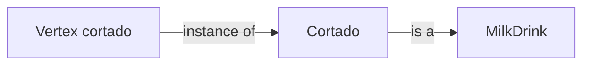

# What are classes and instances?

## In short

A class is a kind of thing, and an instance is one real example of that kind.



Say Vertex Coffee sells a drink called a cortado. "Cortado" is the kind: you can have two of them, one per customer. "Vertex cortado" is one cup on one menu. You describe the kind once, and every example inherits that description.

## See it

This is a small part of the ontology you build in the [espresso tutorial](../../examples/espresso/tutorial/0-intro.md). A made-up café called Vertex Coffee serves the drinks, so "Vertex cortado" is that café's cortado. A ring is a class, and a dot is an instance. The dashed outline marks the class this page is about.

<okb-graph src="/data/espresso.json" focus="Cortado, Latte, Vertex cortado" highlight="Cortado" label="The Cortado class, its place under MilkDrink, and Vertex cortado, one cortado on the menu">
<p>The graph shows the Cortado class and one real cortado from the Vertex Coffee menu.</p>
<ul>
<li>Vertex cortado is an instance of Cortado. It contains Double shot and Steamed whole milk.</li>
<li>Cortado and Latte are kinds of MilkDrink. MilkDrink is a kind of EspressoDrink, which is a kind of Drink. Breve is a kind of Latte, and it is a variation of Latte.</li>
</ul>
</okb-graph>

Notice that the ring, Cortado, sits inside a hierarchy and the dot, Vertex cortado, doesn't. A [class](../GLOSSARY.md#concept-class) can have [subclasses](../GLOSSARY.md#concept-subclass) and instances. An [instance](../GLOSSARY.md#concept-instance) is a leaf: nothing sits below it. The instance holds its own facts, like what went into this cup, and borrows the rest from its class.

## Class or instance?

Is Cortado a class or an instance? It depends on your questions. Vertex Coffee's [competency questions](../GLOSSARY.md#concept-competency-question) include "What's the difference between a cortado and a latte?" That compares kinds of drinks, and each kind has its own facts, so Cortado is a class. The ontology records this as a [design decision](../GLOSSARY.md#concept-design-decision), "Cortado is a class".

A café that only listed menu items, with no need to compare kinds, could make every drink an instance. Neither answer is wrong. The test is what your questions need. The [instance or class decision guide](../DECISIONS.md#decision-instance-or-class) walks through it.

## In okb

Run [`okb show`](../CLI.md#cmd-show) on the class from the `espresso` folder that the tutorial builds.

```bash
okb show Cortado
```

You'll see the class, where it sits, and the facts it carries:

```text
Cortado  Class · c.cortado
  Espresso cut with an equal amount of warm milk.
  parents        MilkDrink
  subclasses     —

  Slots  (properties hold values; relationships → link to other things)
    espressoToMilkRatio Float, single (from MilkDrink)
                       fixed = 1
    texture            Enumerated, {silky, foamy, thick}, single (from MilkDrink)
    pullVolumeMl       Integer, single (from EspressoDrink)
    pourOrder          String, single (from Drink)
    origin             String, single (from Drink)
                       fixed = Spain
    contains           Instance, → Ingredient (:CONTAINS), multiple, min 1, inverse of usedIn (from Drink)
    variationOf        Instance, → Drink (:VARIATION_OF), multiple (from Drink)
  instances      Vertex cortado

  Design decisions
    d.5: Cortado is a class. Every drink type, Cortado included, is a class. Items on the menu
    are instances.
```

The `instances` line lists Vertex cortado, the dot in the graph. The `fixed` lines are facts every cortado shares, so no instance repeats them. The last block is the decision that made Cortado a class.

> **Common mistakes**
>
> - **Making a drink an instance too early.** "Vertex cortado" is one cup. If you model "Cortado" that way, you can't give the kind its own facts or compare it with a latte.
> - **Making a class for each cup.** A class for every cup on the menu has one member each, and the hierarchy fills with noise.
> - **Skipping the question.** The answer depends on what your ontology must answer. Write the competency questions first, then decide.

## Related pages

- [Step 4 of the espresso tutorial](../../examples/espresso/tutorial/4-classes.md) adds Cortado as a class, and [step 7](../../examples/espresso/tutorial/7-instances.md) adds Vertex cortado.
- [Instance or class?](../DECISIONS.md#decision-instance-or-class) is the decision guide for choosing.
- [What is a knowledge graph?](knowledge-graphs.md) shows why links between things matter. The next pages are Hierarchy and Disjoint classes and multiple parents.
- [Glossary](../GLOSSARY.md) defines every term used here.

## Sources

[_Ontology Development 101_](https://protege.stanford.edu/publications/ontology_development/ontology101.pdf) by Noy and McGuinness (PDF), page 18: "Deciding whether a particular concept is a class in an ontology or an individual instance depends on what the potential applications of the ontology are."
