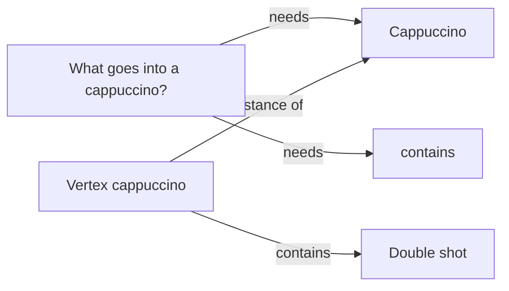

# Why start with questions?

## In short

A competency question is a question your ontology must be able to answer, and the questions tell you which kinds and links to build.



Without questions, you may model everything you can think of about coffee and never finish. With them, you know when you're done: you can answer each question from the graph. Vertex Coffee, a made-up café, starts with "What goes into a cappuccino?" That one question already says you need a kind called Cappuccino and a link called `contains`.

## See it

This graph comes from the [espresso tutorial](../../examples/espresso/tutorial/0-intro.md). [How to read the graphs](index.md#how-to-read-the-graphs) explains rings and dots. The question is a node too. It points at what it needs, and the dashed outline marks it. The slot `contains` is a dot as well, but it is part of the plan, not a real drink.

<okb-graph src="/data/espresso.json" focus="cq.3, Cappuccino, contains, Vertex cappuccino" show="CompetencyQuestion, Slot" highlight="cq.3" label="The question 'What goes into a cappuccino?' linked to the class and slot that answer it, with the real drink Vertex cappuccino">
<p>The graph shows the question "What goes into a cappuccino?" and the parts of the espresso ontology that answer it.</p>
<ul>
<li>The question needs the class Cappuccino and the slot contains. Two other questions, "Which drinks have no milk?" and "Which drinks on the menu come with chocolate?", need contains too.</li>
<li>Vertex cappuccino is an instance of Cappuccino. It contains Double shot, Steamed whole milk and Milk foam.</li>
<li>Cappuccino is a kind of Milk drink, which is a kind of Espresso drink, which is a kind of Drink.</li>
</ul>
</okb-graph>

Notice that the answer is a path. Start at Cappuccino, find its drink, and follow the `contains` links. If a question needs a kind or link that doesn't exist, you've found something to add. If a kind or link answers no question, you may not need it. A [competency question](../GLOSSARY.md#concept-competency-question) also sets the [scope](../GLOSSARY.md#concept-scope) of your ontology: what it covers and what it leaves out.

## In okb

Add questions with `okb cq add`, and link each one to what answers it. [`okb cq list`](../CLI.md#cmd-cq-list) shows them all and what each one needs. Run it from the espresso folder.

```bash
okb cq list
```

```text
cq.1   Which drinks have no milk? [draft]
       needs: Drink, contains, Milk
cq.2   What's the difference between a cortado and a latte? [draft]
       needs: Cortado, Latte, espressoToMilkRatio, texture
cq.3   What goes into a cappuccino? [draft]
       needs: Cappuccino, contains
cq.4   Which drinks are a variation of another drink? [draft]
       needs: variationOf, Breve
cq.5   Which drinks on the menu come with chocolate? [draft]
       needs: contains, Chocolate, Mocha
cq.6   How much does each drink cost? [draft]
       needs: (not linked yet: okb cq link 6 <Class|slot>...)
```

The `cq.3` line is the graph above: its two needs are the two links out of the question node. Question 6 needs nothing yet. That is the useful signal: the ontology has no price slot, so it can't answer it. okb warns about a question with no links.

> **Common mistakes**
>
> - **Writing questions as topics.** "Drinks" is a topic. "Which drinks have no milk?" is a question, and you can check it against the graph.
> - **Trying to write them all first.** A sketch of five or six is enough. Add more as you learn.
> - **Never linking them.** An unlinked question is a wish. Linking shows what the ontology still lacks.

## Related pages

- [The espresso tutorial](../../examples/espresso/tutorial/1-scope.md) writes these questions in its scope step.
- [The wine tutorial](../../examples/wine/tutorial/1-scope.md) does the same with wine questions.
- [What is a knowledge graph?](knowledge-graphs.md) covers the nodes and links that the questions point at.
- [What are classes and instances?](classes-and-instances.md) is the next page: it turns the kinds of thing in your questions into classes.
- [Choosing a new class](../DECISIONS.md#decision-new-class) helps when a question needs a kind you don't have.
- [Glossary](../GLOSSARY.md) defines every term used here.

## Sources

[_Ontology Development 101_](https://protege.stanford.edu/publications/ontology_development/ontology101.pdf) by Noy and McGuinness (PDF), page 5: "These questions will serve as the litmus test later: Does the ontology contain enough information to answer these types of questions?"
