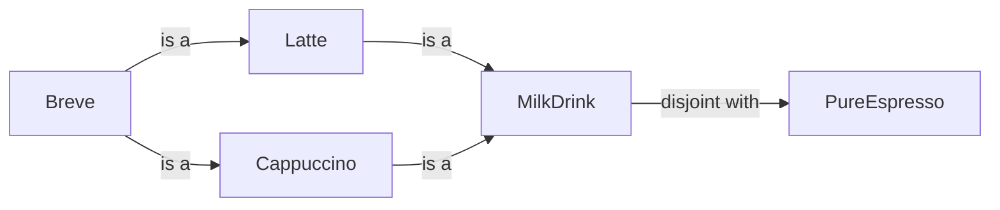

# Can a drink be two kinds at once?

## In short

Two classes are disjoint when nothing can belong to both, and a class has multiple parents when it is a kind of more than one thing.



A drink with milk can't be a drink with only coffee and water. That's a rule you want okb to enforce. But a breve is a latte and a cappuccino at once, made with half-and-half. That's a fact you want okb to allow. One idea blocks overlap, and the other permits it.

## See it

This is a small part of the ontology you build in the [espresso tutorial](../../packages/okb/examples/espresso/tutorial/0-intro.md), for the made-up café Vertex Coffee ([how to read the graphs](index.md#how-to-read-the-graphs)). The dashed outline marks the class this page is about.

<okb-graph src="/data/espresso.json" focus="Breve, PureEspresso" highlight="Breve" label="Breve with its two parents, and PureEspresso, which is disjoint with MilkDrink">
<p>The graph shows Breve with two parents, and the groups of drinks that can't overlap.</p>
<ul>
<li>Breve is a kind of Latte and a kind of Cappuccino. Both are kinds of MilkDrink.</li>
<li>Vertex breve is an instance of Breve.</li>
<li>MilkDrink, PureEspresso and SweetenedDrink are kinds of EspressoDrink. Each pair is disjoint.</li>
<li>Espresso, Ristretto, Lungo, Americano and LongBlack are kinds of PureEspresso, and they are disjoint with each other.</li>
</ul>
</okb-graph>

Notice that Breve has two "is a" links up, which is [multiple inheritance](../GLOSSARY.md#concept-multiple-inheritance). It gets the [slots](../GLOSSARY.md#concept-slot), the named fields such as `origin`, from both parents. Latte and Cappuccino are not disjoint, because a breve is both. MilkDrink and PureEspresso are [disjoint](../GLOSSARY.md#concept-disjoint): a drink with milk isn't a pure espresso. Declare disjoint groups wherever nothing could belong to two siblings. The [disjoint decision guide](../DECISIONS.md#decision-disjoint) has one question for it.

## In okb

Try to give a new class a parent from each of two disjoint groups. Run [`okb class add`](../CLI.md#cmd-class-add) from the `espresso` folder.

```bash
okb class add Cortadito --parent PureEspresso --parent MilkDrink
```

okb refuses:

```text
✗ Cortadito can't be under both PureEspresso and MilkDrink: they're declared disjoint, so nothing can be both (rule disjoint-no-shared-members).
```

Adding `--parent Latte --parent Cappuccino` is allowed, because those two aren't disjoint. That's how the tutorial adds Breve.

> **Common mistakes**
>
> - **Declaring Latte and Cappuccino disjoint.** A breve is both, so okb would report an error.
> - **Forgetting the second parent.** Without it, okb can't tell that a breve is also a cappuccino.
> - **Skipping disjoint groups.** Without them, okb can't catch a drink filed as both pure espresso and milk drink.
> - **Two parents for convenience.** Use a second parent only when every member is truly both. Otherwise you inherit facts that don't fit.

## Related pages

- [Step 4 of the espresso tutorial](../../packages/okb/examples/espresso/tutorial/4-classes.md) adds Breve with two parents and declares the disjoint groups.
- [Step 6 of the espresso tutorial](../../packages/okb/examples/espresso/tutorial/6-facets.md) shows how defaults settle facts that two parents disagree on.
- [Are these classes disjoint?](../DECISIONS.md#decision-disjoint) is the decision guide for each pair of siblings.
- [What does "is a kind of" mean?](hierarchy.md) explains the "is a" links that these rules build on.
- [Properties or relationships?](properties-and-relationships.md) is the next page: it moves from kinds of thing to facts about them.
- [Glossary](../GLOSSARY.md) defines every term used here.

## Sources

[_Ontology Development 101_](https://protege.stanford.edu/publications/ontology_development/ontology101.pdf) by Noy and McGuinness (PDF), page 20: "Classes are disjoint if they cannot have any instances in common."
