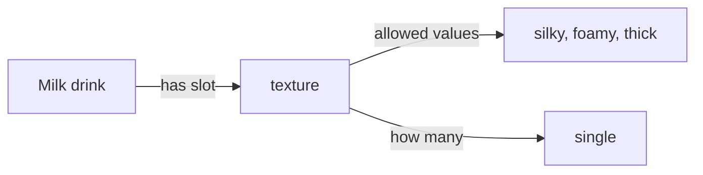

# What are facets?

## In short

A facet is a rule about the values a slot may hold, such as the type, the allowed words or how many values it takes.



Say a barista types "crunchy" for the texture of a latte. A slot with no rules accepts it. A slot with an allowed-values rule refuses it, and you find out at once instead of when a report goes wrong. Facets are those rules.

## See it

This slot comes from the [espresso tutorial](../../examples/espresso/tutorial/0-intro.md), where a made-up café called Vertex Coffee serves the drinks. A ring is a kind of thing. The graph shows slots too, so you can see the slot `texture` next to the kind it belongs to. Click the slot to read its rules.

<okb-graph src="/data/espresso.json" focus="MilkDrink, texture, contains" highlight="texture" show="Slot" label="The texture slot on Milk drink and the contains slot on Drink, with their rules">
<p>The graph shows slots and the rules on them.</p>
<ul>
<li><code>texture</code> is attached to Milk drink. Its value type is Enumerated, and the allowed values are silky, foamy and thick. It takes one value.</li>
<li><code>contains</code> is attached to Drink. It links to Ingredient, takes many values and needs at least one.</li>
</ul>
</okb-graph>

Notice that the facets are of different kinds. The [value type](../GLOSSARY.md#concept-value-type) says what the value is: a whole number, text, one of a list, or a link. [Cardinality](../GLOSSARY.md#concept-cardinality) says how many values: `single` or `multiple`, with an optional minimum. A [facet](../GLOSSARY.md#concept-facet) can also be a fixed value, such as every lungo pulling 60 ml. The espresso ontology sets no numeric range on `pullVolumeMl`. It only says the value is a whole number and fixes it for Espresso (30), Ristretto (20) and Lungo (60).

## In okb

Try to break a rule. Run [`okb instance set`](../CLI.md#cmd-instance-set) with a texture that isn't allowed.

```bash
okb instance set "Vertex cortado" texture=crunchy
okb instance set "Vertex cortado" pullVolumeMl=abc
```

```text
✗ texture must be one of silky, foamy, thick; got 'crunchy'.
✗ pullVolumeMl needs a whole number; got 'abc'.
```

okb refuses both, so nothing is saved. The first message names the allowed values and the second names the value type.

> **Common mistakes**
>
> - **Leaving a slot as free text.** "Silky" and "silky " become two different values, and queries miss them.
> - **No minimum on a required link.** A drink that contains nothing passes, unless `contains` has a minimum of 1.
> - **A rule that's too tight.** If you forget "thick", real drinks can't be recorded.

## Related pages

- [The espresso tutorial, step 6](../../examples/espresso/tutorial/6-facets.md) sets these rules one by one.
- [Choosing a range](../DECISIONS.md#decision-range) covers what a link may point to.
- [What is a knowledge graph?](knowledge-graphs.md) is the place to start if the graph is new to you.
- [Glossary](../GLOSSARY.md) defines every term used here.

## Sources

[_Ontology Development 101_](https://protege.stanford.edu/publications/ontology_development/ontology101.pdf) by Noy and McGuinness (PDF), page 9: "Slots can have different facets describing the value type, allowed values, the number of the values (cardinality), and other features of the values the slot can take."
