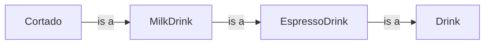

# What does "is a kind of" mean?

## In short

A class hierarchy stacks kinds of things so that each kind inherits everything true of the kinds above it.



Every cortado is a milk drink. Every milk drink is an espresso drink. Every espresso drink is a drink. Whatever you say about drinks, such as "has an origin", is true of a cortado too, and you say it once.

## See it

This is a small part of the ontology you build in the [espresso tutorial](../../examples/espresso/tutorial/0-intro.md), for the made-up café Vertex Coffee ([how to read the graphs](index.md#how-to-read-the-graphs)). Every node here is a ring, a kind of drink. The dashed outline marks the class this page is about.

<okb-graph src="/data/espresso.json" focus="MilkDrink" highlight="MilkDrink" label="MilkDrink in the Drink hierarchy: its parents, its five subclasses and the kinds it can't overlap with">
<p>The graph shows MilkDrink and the kinds around it in the Vertex Coffee drink hierarchy.</p>
<ul>
<li>MilkDrink is a kind of EspressoDrink, which is a kind of Drink.</li>
<li>Cappuccino, Cortado, FlatWhite, Latte and Macchiato are kinds of MilkDrink.</li>
<li>PureEspresso and SweetenedDrink are also kinds of EspressoDrink. Each is disjoint with MilkDrink, which means a drink can't be both.</li>
</ul>
</okb-graph>

Read each "is a" link upward: Cortado is a MilkDrink. The class above is the [superclass](../GLOSSARY.md#concept-subclass), and the one below is the subclass. A subclass [inherits](../GLOSSARY.md#concept-inheritance) every [slot](../GLOSSARY.md#concept-slot) of its parents (a slot is a named field, such as `origin`), so a Cortado has `origin` without anyone adding it there. The whole structure is the [class hierarchy](../GLOSSARY.md#concept-class-hierarchy). Drink, EspressoDrink and MilkDrink are [abstract classes](../GLOSSARY.md#concept-abstract-class): they group other kinds, and no one orders "a milk drink".

## Test each link

Before you add an "is a" link, say it out loud: "every Cortado is a MilkDrink". If that's true by definition, add it. If it's only often true, or it means "has" or "is part of", it isn't an "is a". The [is-a decision guide](../DECISIONS.md#decision-is-a) has the full check.

## In okb

Run [`okb tree`](../CLI.md#cmd-tree) from the `espresso` folder to print the hierarchy.

```bash
okb tree
```

You'll see the Drink tree, then the Ingredient tree:

```text
Drink (abstract)
  └ EspressoDrink (abstract)
    └ MilkDrink (abstract)
      └ Cappuccino
        └ Breve (also under Latte)
      └ Cortado
      └ FlatWhite
      └ Latte
        └ Breve (see above)
      └ Macchiato
    └ PureEspresso (abstract)
      └ Americano
      └ Espresso
      └ LongBlack
      └ Lungo
      └ Ristretto
    └ SweetenedDrink (abstract)
      └ Affogato
      └ CafeBombon
      └ ConPanna
      └ Mocha
Ingredient (abstract)
  └ Chocolate
  └ Coffee
  └ Foam
  └ Gelato
  └ Milk (abstract)
    └ CondensedMilk
    └ HalfAndHalf
    └ WholeMilk
  └ Water
  └ WhippedCream
```

Each indented line is one "is a" link, the same ones as in the graph. The `MilkDrink` branch has five children, and the Ingredient tree is a separate hierarchy.

> **Common mistakes**
>
> - **Using "is a" for "has".** A Cortado contains espresso, but it isn't an espresso. Use a relationship such as `contains` for that.
> - **Using "is a" for "is part of".** A foam layer is part of a cappuccino. It isn't a kind of cappuccino.
> - **Plural names.** `Cortados` instead of `Cortado`. Name each class in the singular, so every link reads "a Cortado is a MilkDrink".
> - **Skipping the middle.** If every drink hangs straight off Drink, you can't ask "which drinks have milk?" in one step.

## Related pages

- [Step 4 of the espresso tutorial](../../examples/espresso/tutorial/4-classes.md) builds this tree one class at a time.
- [The wine tutorial](../../examples/wine/tutorial/4-classes.md) builds a larger tree.
- [Is it an "is a"?](../DECISIONS.md#decision-is-a) is the decision guide for each link.
- [What are classes and instances?](classes-and-instances.md) explains the other kind of link, "instance of".
- [Can a drink be two kinds at once?](disjoint-and-multiple-parents.md) is the next page: it covers siblings that can't overlap and classes with two parents.
- [Glossary](../GLOSSARY.md) defines every term used here.

## Sources

[_Ontology Development 101_](https://protege.stanford.edu/publications/ontology_development/ontology101.pdf) by Noy and McGuinness (PDF), page 12: "The class hierarchy represents an “is-a” relation: a class A is a subclass of B if every instance of A is also an instance of B."
