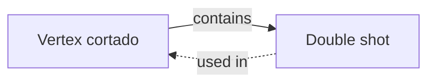

# What is an inverse relationship?

## In short

Two relationships are inverses when they are the same link read from opposite ends, so you state the fact once and read it both ways.



Say you record that Vertex cortado contains a Double shot. Someone later asks which drinks use a Double shot. You don't want to type every fact twice, and you don't want the two copies to disagree. With inverses you type it once.

## See it

This is from the [espresso tutorial](../../examples/espresso/tutorial/0-intro.md), where a made-up café called Vertex Coffee serves the drinks. A dot is one real example, and a ring is a kind of thing. Slots are switched on so you can see the pair of them.

<okb-graph src="/data/espresso.json" focus="Vertex cortado, Double shot, contains, usedIn" highlight="usedIn" show="Slot" label="Vertex cortado, Double shot and the contains and <code>usedIn</code> slots that are inverses">
<p>The graph shows Double shot, the drinks that contain it and the two slots that describe the link. Vertex cortado is the one to follow.</p>
<ul>
<li>Vertex cortado contains Double shot. This is the one stored link.</li>
<li><code>contains</code> is attached to Drink. <code>usedIn</code> is attached to Ingredient. The two slots are inverses of each other.</li>
<li>Double shot is used in Vertex cortado and seven other drinks. These come from reading the same links backwards.</li>
</ul>
</okb-graph>

Notice there is only one arrow between the drink and the ingredient. The inverse slot doesn't add a second one. It reads that one arrow from the other end. Because of this, the two views can't drift apart: change the link, and both views change. The ontology says this with [inverse slots](../GLOSSARY.md#concept-inverse-slots).

## In okb

Run [`okb show`](../CLI.md#cmd-show) on the slot from the ingredient end, from the `espresso` folder.

```bash
okb show usedIn
okb show "Double shot"
```

```text
usedIn  Slot · s.used-in
  Drinks the ingredient goes into.
  kind           relationship (links to other things)
  facets         Instance, → Drink (reads :CONTAINS backwards), multiple, inverse of contains
  edge props     amount (Enumerated {splash, equal, topUp}) + rule
  attached to    Ingredient
Double shot  Instance · i.double-shot
  instance of    Coffee

  Values
    usedIn             House espresso, Vertex cortado, Vertex flat white, Vertex cappuccino, Vertex breve, Vertex mocha, Vertex affogato, Vertex macchiato
```

The phrase `reads :CONTAINS backwards` is the point. Nobody typed those eight drinks into Double shot. They come from the `contains` links on the drinks.

> **Common mistakes**
>
> - **Adding the link at both ends.** You only state it once. The inverse is filled in.
> - **Declaring inverses for unrelated links.** `contains` and `variationOf` point the same way, so they aren't a pair.
> - **Forgetting the range.** The two slots must point at each other's kinds: Drink at one end, Ingredient at the other.

## Related pages

- [The espresso tutorial, step 6](../../examples/espresso/tutorial/6-facets.md) declares this pair.
- [Choosing the range of a relationship](../DECISIONS.md#decision-range) covers what each end may point to.
- [What is a knowledge graph?](knowledge-graphs.md) explains nodes and links.
- [Glossary](../GLOSSARY.md) defines every term used here.

## Sources

[_Ontology Development 101_](https://protege.stanford.edu/publications/ontology_development/ontology101.pdf) by Noy and McGuinness (PDF), page 21: "The slot produces for the class Winery is an inverse of the slot maker for the class Wine."
