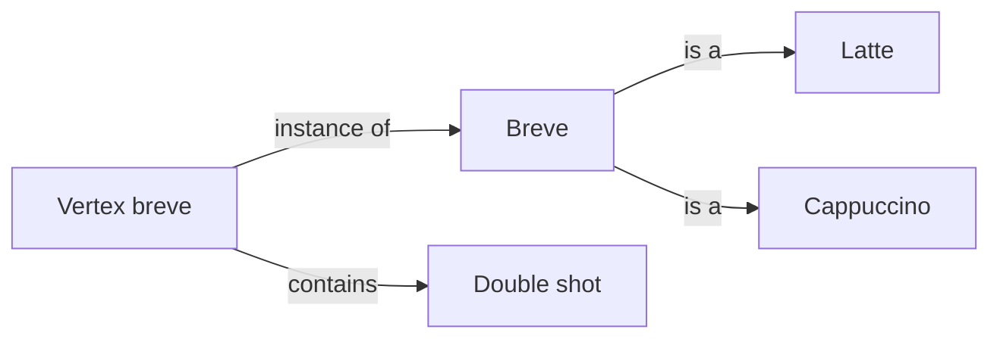

# What is a knowledge graph?

## In short

A knowledge graph stores facts as things (nodes) joined by named links (edges), so a program can follow the links to answer a question.



Say a café, Vertex Coffee, wants to answer "which drinks have no milk?" A list of drink names can't. A graph can. "Vertex breve contains Steamed half-and-half" is a link a program can follow. "Breve is a kind of Latte" shows what else is true about a breve. Without the links, you have a pile of words.

## See it

This is a small part of the ontology you build in the [espresso tutorial](../../examples/espresso/tutorial/0-intro.md). In that tutorial, a made-up café called Vertex Coffee serves the drinks, so "Vertex breve" is that café's breve, one real drink on its menu. Click a node to read about it. Drag a node to move it, drag the background to pan, and click the graph before you scroll to zoom. A ring is a kind of thing, and a dot is one real example of it. The dashed outline marks the drink this page is about.

<okb-graph src="/data/espresso.json" focus="Corner breve, Corner cappuccino" highlight="Corner breve" label="Part of the espresso ontology: two drinks, what they contain and the kinds they belong to">
<p>The graph shows two drinks from the Vertex Coffee menu in the espresso ontology.</p>
<ul>
<li>Vertex breve is an instance of Breve. It contains Double shot, Steamed half-and-half and Milk foam.</li>
<li>Vertex cappuccino is an instance of Cappuccino. It contains Double shot, Steamed whole milk and Milk foam.</li>
<li>Breve is a kind of Latte and a kind of Cappuccino. Latte and Cappuccino are kinds of Milk drink, which is a kind of Espresso drink, which is a kind of Drink.</li>
</ul>
</okb-graph>

Notice the two kinds of link. "Is a" links stack kinds on top of each other, from Breve up to Drink. "Instance of" links join one real drink to its kind. Those two make a knowledge graph more than a pile of facts. The first one is the [class hierarchy](../GLOSSARY.md#concept-class-hierarchy), and an [instance](../GLOSSARY.md#concept-instance) is one real example of a [class](../GLOSSARY.md#concept-class).

## What okb adds

A graph alone doesn't stop you from linking a Milk drink to a bicycle. An [ontology](../GLOSSARY.md#concept-ontology) is the part that says which kinds exist and how they may connect. The ontology plus its real examples is a [knowledge base](../GLOSSARY.md#concept-knowledge-base). The okb files (`nodes.json` and `edges.json`) are a graph too, and every class, slot and instance in them is a node. See the [file format](../FORMAT.md) for the details.

## In okb

Run [`okb show`](../CLI.md#cmd-show) on a drink to see its links. Run it from the `espresso` folder that the [espresso tutorial](../../examples/espresso/tutorial/0-intro.md) builds.

```bash
okb show "Vertex breve"
```

You'll see the kind it belongs to, and then each fact. The links show up as values:

```text
Vertex breve  Instance · i.vertex-breve
  instance of    Breve

  Values
    espressoToMilkRatio 0.33
    texture            foamy
    pullVolumeMl       —
    pourOrder          Shot, half-and-half, then foam
    origin             USA
    contains           Double shot, Steamed half-and-half, Milk foam
    variationOf        Latte, Cappuccino (fixed by Breve)
```

The `contains` line is three edges in the graph earlier on this page. The `variationOf` line is two more, and okb filled them in from the class, so you didn't have to repeat them for every drink.

## Explore it all

Here is the whole espresso ontology: 31 classes and 16 instances. Use the checkboxes to add the terms, slots and competency questions that built it.

<okb-graph src="/data/espresso.json" label="The whole espresso ontology">
<p>The espresso ontology has 31 classes and 16 instances.</p>
<ul>
<li>Drink is the top class. Espresso drink, Milk drink, Pure espresso and Sweetened drink sit below it, with the drinks themselves below those, such as Cortado, Latte, Mocha and Breve.</li>
<li>Ingredient is the other top class. It has Coffee, Water, Milk, Foam, Chocolate, Whipped cream and Gelato.</li>
<li>Sixteen instances tie the two together, such as Vertex cortado, which contains Double shot and Steamed whole milk.</li>
</ul>
</okb-graph>

> **Common mistakes**
>
> - **Thinking the graph is the picture.** The picture is one view. The nodes and edges in the files are the knowledge.
> - **Mixing up a kind and an example.** "Breve" is a kind of drink. "Vertex breve" is one on the menu. Without the difference, you can't ask "which of our drinks are lattes?"
> - **Linking everything to everything.** A link needs a name, such as `contains`, and the kinds at each end must make sense for it.

## Related pages

- [The espresso tutorial](../../examples/espresso/tutorial/0-intro.md) builds this graph from nothing, one step at a time.
- [The wine tutorial](../../examples/wine/tutorial/0-intro.md) shows the same idea with a larger ontology.
- [Choosing between a class and an instance](../DECISIONS.md#decision-instance-or-class) helps when you aren't sure which one a thing is.
- [Glossary](../GLOSSARY.md) defines every term used here.

## Sources

[_Ontology Development 101_](https://protege.stanford.edu/publications/ontology_development/ontology101.pdf) by Noy and McGuinness (PDF), page 3: "An ontology together with a set of individual instances of classes constitutes a knowledge base."
