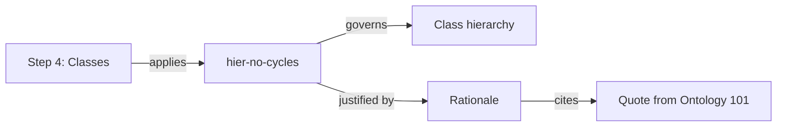

# Where do the rules come from?

## In short

Every rule okb checks is written down in a knowledge base of its own, the meta-KB, with a strength and a quote from the source that backs it.



Say okb tells you a loop in the [class hierarchy](../GLOSSARY.md#concept-class-hierarchy), where kinds stack by "is a kind of", is an error. Why should you believe it? Because the rule isn't a hunch in the code. It's a node in a graph, and you can follow its links to the sentence in the paper that it comes from. A rule you can trace is one you can argue with.

## See it

This graph is not from the espresso ontology. It's a small piece of the meta-KB: one rule, the [step](../METHOD.md#step-4-classes) of the method that applies it, the idea it governs, and the quote behind it. Click a node to read about it. A ring is a kind of thing or an idea, and a dot is one example. The dashed outline marks the rule.

<okb-graph src="/data/meta-kb.json" focus="rule.hier-no-cycles, rat.hier-no-cycles" highlight="rule.hier-no-cycles" show="Rule,Rationale,SourceLocation" label="The rule hier-no-cycles, the step that applies it, the idea it governs, and the quote that justifies it">
<p>The graph shows one rule from the meta-KB, hier-no-cycles.</p>
<ul>
<li>Step 4, Define the classes and the class hierarchy, applies the rule.</li>
<li>The rule governs the concept Class hierarchy (taxonomy).</li>
<li>The rule is justified by a rationale. The rationale cites a quote from Ontology 101, page 13, about avoiding cycles in the class hierarchy.</li>
</ul>
</okb-graph>

Notice the path from the rule to the quote. Each rule has a reason and each reason cites a source. A rule with no source says so plainly. The meta-KB marks it as a toolkit convention instead of passing it off as the paper's advice.

## Strength

Each rule has a strength, taken from the words in its source. "Must" is a MUST, "should" is a SHOULD, and "consider" or "may" is a MAY. okb maps them to findings: MUST becomes an error, SHOULD a warning and MAY a hint. Of the 57 rules, 24 are MUST or MUST NOT, 28 are SHOULD or SHOULD NOT, and 5 are MAY. A rule can override its strength, but only with a written reason. `hier-no-cycles` is a SHOULD NOT in the paper and an error in okb, and says why.

## Explore it all

This is the whole meta-KB, opened on its concepts and steps. Use the checkboxes to add the rules, rationales and quotes.

<okb-graph src="/data/meta-kb.json" label="The meta-KB, opened on its concepts and steps">
<p>The meta-KB opens on 40 concepts and the 8 steps of the method.</p>
<ul>
<li>The steps run in order, from Determine the domain and scope to the review.</li>
<li>Each step introduces the concepts a beginner needs at that point, such as Class hierarchy.</li>
<li>The checkboxes add the 57 rules, their rationales and the quotes from the sources.</li>
</ul>
</okb-graph>

## In okb

Run [`okb explain`](../CLI.md#cmd-explain) with a rule's key. You don't need an ontology folder for this: the meta-KB ships with okb.

```bash
okb explain hier-no-cycles
```

You'll see the strength, the rule in plain words, why it exists and the quote (the output is cut here to the first lines and the source):

```text
Rule hier-no-cycles  (SHOULD NOT · error · mechanical check · basis: direct)

  The class hierarchy should not contain cycles (A is a subclass of B and B is, directly or
  indirectly, a subclass of A).

In plain words
  A class can't be its own ancestor. If A is a kind of B and B is a kind of A, they're the same
  class.

Why
  A cycle amounts to declaring the classes equivalent: all instances of A are instances of B and
  vice versa.
  Severity note: The paper says cycles 'should' be avoided because a cycle declares the classes
  equivalent. The checker can't tell an intended equivalence from a mistake, and okb has no
  equivalence construct, so a cycle is treated as an error: merge the classes and keep the other
  name as a synonym.

How to fix
  If they're the same concept, merge them (keep one name, add the other as a synonym). If not,
  remove the IS_A edge that's wrong.

Source
  “We should avoid cycles in the class hierarchy. We say that there is a cycle in a hierarchy when some class A has a subclass B and at the same time B is a superclass of A. Creating such a cycle in a hierarchy amounts to declaring that the classes A and B are equivalent”
  — Ontology 101 §4.1 Ensuring that the class hierarchy is correct, p.13

  Applies from step 4.
  Read more: https://ontology-kit.dev/reference/rules/#rule-hier-no-cycles
```

The first line holds the strength (`SHOULD NOT`) and the finding level it becomes (`error`). The `Severity note` is the written reason for the override. The `Source` lines are the quote from the graph above. Every rule has a page of its own on the [Rules page](../RULES.md#rule-hier-no-cycles).

> **Common mistakes**
>
> - **Treating a rule as okb's opinion.** Most rules come from a published guide. Read the quote before you decide the rule is wrong.
> - **Treating every rule as equal.** A MUST is an error. A MAY is only a hint. Fix them in that order.
> - **Looking for the meta-KB in your ontology.** Your ontology folder holds your classes and instances. The rules live in okb.

## Related pages

- [The wine tutorial](../../packages/okb/examples/wine/tutorial/0-intro.md) shows rules firing as you build a larger ontology.
- [The Rules page](../RULES.md) lists every rule with its strength, reason, source and the step it starts to apply at.
- [Method](../METHOD.md) explains each step of the method.
- [Glossary](../GLOSSARY.md) defines every term used here.
- [How do I read and fix a finding?](rules-and-findings.md) comes before this page: it shows the findings that these rules produce.
- [What is a knowledge graph?](knowledge-graphs.md) explains the nodes and edges that the meta-KB is made of.

## Sources

[_Ontology Development 101_](https://protege.stanford.edu/publications/ontology_development/ontology101.pdf) by Noy and McGuinness (PDF), page 13: "We should avoid cycles in the class hierarchy."
