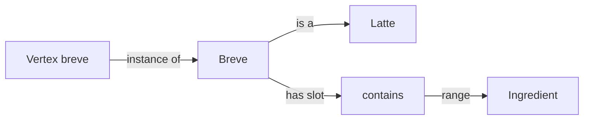

# What is an ontology?

## In short

An ontology is the plan for your data. It says which kinds of things exist and how they can connect.



Think of a database. A table definition says a drink has a name and a list of ingredients. The rows are the actual drinks. An ontology is like the table definition, but it lives in the same files as the data, so you can ask it questions too. The kinds and links are the plan (the schema). The real drinks are the data.

## See it

This graph comes from the [espresso tutorial](../../examples/espresso/tutorial/0-intro.md), where a made-up café called Vertex Coffee sells the drinks. "Vertex breve" is that café's breve. A ring is a kind of thing, and a dot is one real example of it. The dashed outline marks the kind this page is about. The `contains` node is a [slot](../GLOSSARY.md#concept-slot), a named link that a kind of thing can have. It is a dot too, but it belongs to the plan.

<okb-graph src="/data/espresso.json" focus="Vertex breve, Breve, contains" show="Slot" highlight="Breve" label="The plan and the data in the espresso ontology: the kind Breve and its slot contains, and one real drink, Vertex breve">
<p>The graph shows the plan and the data for one drink in the espresso ontology.</p>
<ul>
<li>The plan: Breve is a kind of Latte and a kind of Cappuccino. Latte and Cappuccino are kinds of Milk drink, which is a kind of Espresso drink, which is a kind of Drink.</li>
<li>The plan also holds the slot contains. Drink has it, and it points to Ingredient.</li>
<li>The data: Vertex breve is an instance of Breve. It contains Double shot, Steamed half-and-half and Milk foam, which are real ingredients.</li>
</ul>
</okb-graph>

Notice the two halves. The rings and the `contains` slot are the plan. Vertex breve and its ingredients are the data. Breve says "a breve can contain ingredients." Vertex breve says "this breve contains a double shot." The [class](../GLOSSARY.md#concept-class) is a kind of thing, and an [instance](../GLOSSARY.md#concept-instance) is one real example. The plan is the [ontology](../GLOSSARY.md#concept-ontology). The plan plus its data is a [knowledge base](../GLOSSARY.md#concept-knowledge-base).

## What okb adds

In okb, the plan and the data live in the same two files, `nodes.json` and `edges.json`. A class, a slot and an instance are all nodes. Because the plan is data, okb can check your real drinks against it and tell you when a drink breaks the plan.

## In okb

Run [`okb show`](../CLI.md#cmd-show) on a kind to read the plan for it. Run it from the espresso folder that the tutorial builds.

```bash
okb show Breve
```

```text
Breve  Class · c.breve
  A latte or cappuccino made with half-and-half instead of milk.
  parents        Latte, Cappuccino
  subclasses     —

  Slots  (properties hold values; relationships → link to other things)
    espressoToMilkRatio Float, single (from MilkDrink)
    texture            Enumerated, {silky, foamy, thick}, single (from MilkDrink)
    pullVolumeMl       Integer, single (from EspressoDrink)
    pourOrder          String, single (from Drink)
    origin             String, single (from Drink)
                       default here = "USA"
    contains           Instance, → Ingredient (:CONTAINS), multiple, min 1, inverse of usedIn (from Drink)
    variationOf        Instance, → Drink (:VARIATION_OF), multiple (from Drink)
                       fixed = Latte, Cappuccino
  instances      Vertex breve
```

This output is all plan, with no real drink values. It lists the slots a breve can have, and where each one comes from. Breve gets `contains` from Drink. The last line points to the data: one instance, Vertex breve. Run `okb show "Vertex breve"` to see its values.

> **Common mistakes**
>
> - **Putting real drinks in the plan.** "Vertex breve" is one drink on one menu. If you make it a class, you can't ask which drinks are breves.
> - **Treating the plan as a form to fill in once.** The plan changes as you learn. Questions you can't answer show you what to add.
> - **Thinking the plan has to be big.** A few kinds and slots that answer your questions are enough.

## Related pages

- [The espresso tutorial](../../examples/espresso/tutorial/0-intro.md) builds the plan and then adds the real drinks.
- [The wine tutorial](../../examples/wine/tutorial/0-intro.md) shows the same split with a larger ontology.
- [What is a knowledge graph?](/learn/knowledge-graphs/) shows the links that both the plan and the data use.
- [Choosing between a class and an instance](../DECISIONS.md#decision-instance-or-class) helps when you aren't sure which side a thing belongs on.
- [Glossary](../GLOSSARY.md) defines every term used here.

## Sources

[_Ontology Development 101_](https://protege.stanford.edu/publications/ontology_development/ontology101.pdf) by Noy and McGuinness (PDF), page 3: "an ontology is a formal explicit description of concepts in a domain of discourse (classes (sometimes called concepts)), properties of each concept describing various features and attributes of the concept (slots (sometimes called roles or properties)), and restrictions on slots (facets (sometimes called role restrictions))."
