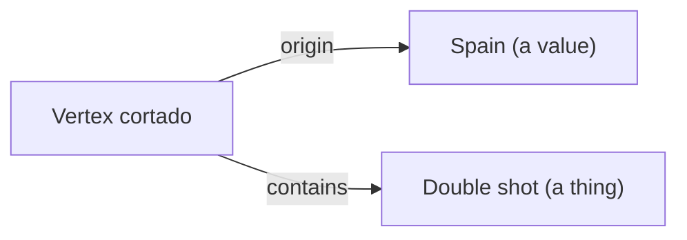

# Properties or relationships?

## In short

A property holds a plain value, such as a number or a word, and a relationship links one thing to another thing.



Say Vertex Coffee wants to know where a cortado comes from and what goes in it. "Spain" is just a word. Nothing else in the ontology is called Spain. A double shot is different: it is a thing with its own facts, and other drinks use it too. The first is a property. The second is a relationship. In okb both are [slots](../GLOSSARY.md#concept-slot), the fields you can fill in for a kind of thing.

## See it

This graph is from the [espresso tutorial](../../examples/espresso/tutorial/0-intro.md), for the made-up café Vertex Coffee ([how to read the graphs](index.md#how-to-read-the-graphs)). Slots are switched on here so you can see the fields. Click a node to read about it.

<okb-graph src="/data/espresso.json" focus="Vertex cortado, Double shot" highlight="Vertex cortado" show="Slot" label="Vertex cortado, the drinks and ingredients it links to, and the slots that describe it">
<p>The graph shows one drink from the Vertex Coffee menu, with the slots that describe drinks.</p>
<ul>
<li>Vertex cortado is an instance of Cortado, a kind of milk drink.</li>
<li>Vertex cortado contains Double shot and Steamed whole milk. These are links to other things.</li>
<li>Vertex cortado also has plain values: <code>origin</code> is Spain and <code>texture</code> is silky. These are not links, so they appear in the inspector and not as separate nodes.</li>
</ul>
</okb-graph>

Notice that `contains` makes edges to real nodes, and `origin` does not. You can follow a relationship to find out more, such as which other drinks use the same Double shot. You can only read a property. The CLI treats them differently for this reason: a relationship's value must be a thing that exists.

## In okb

Run [`okb show`](../CLI.md#cmd-show) on a slot to see which kind it is. Run it from the `espresso` folder.

```bash
okb show origin
okb show contains
```

```text
origin  Slot · s.origin
  Where the drink was first made.
  kind           property (holds a value)
  facets         String, single
  attached to    Drink
contains  Slot · s.contains
  What goes into the drink.
  kind           relationship (links to other things)
  facets         Instance, → Ingredient (:CONTAINS), multiple, min 1, inverse of usedIn
  edge props     amount (Enumerated {splash, equal, topUp}) + rule
  attached to    Drink
```

Look at the `kind` line. `origin` is a property, so its [facets](../GLOSSARY.md#concept-facet), the rules on its values, say `String`. `contains` is a relationship, so its facets say `Instance`, and the arrow names the kind of thing it points to: `Ingredient`.

> **Common mistakes**
>
> - **Storing a thing as text.** Typing "Double shot" into a text field means okb can't tell you which drinks contain it. Link to the thing instead.
> - **Making a relationship for a plain fact.** "Origin: Spain" doesn't need a Spain node unless you plan to say more about Spain.
> - **Forgetting the target kind.** A relationship needs a kind of thing at the other end, or any link will pass.

## Related pages

- [The espresso tutorial, step 5](../../examples/espresso/tutorial/5-slots.md) adds these slots one at a time.
- [Choosing between a class and a value](../DECISIONS.md#decision-class-or-value) helps when a fact might be a thing.
- [Choosing the range of a relationship](../DECISIONS.md#decision-range) covers what a link may point to.
- [What are classes and instances?](classes-and-instances.md) explains the things that these facts describe.
- [What is slot inheritance?](slot-inheritance.md) is the next page: it shows how a fact on a class reaches everything below it.
- [Glossary](../GLOSSARY.md) defines every term used here.

## Sources

[_Ontology Development 101_](https://protege.stanford.edu/publications/ontology_development/ontology101.pdf) by Noy and McGuinness (PDF), page 3: "Slots describe properties of classes and instances"
