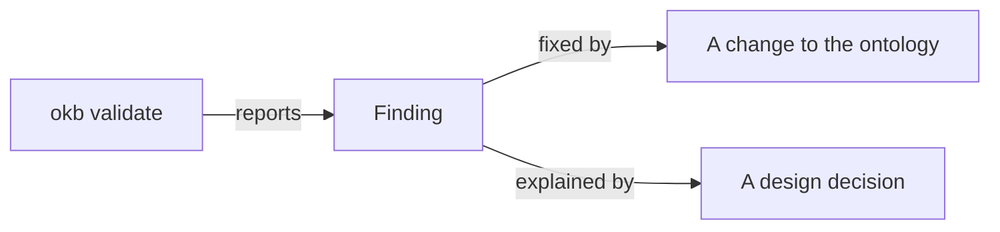

# How do I read and fix a finding?

## In short

A finding is okb telling you that part of your ontology breaks a rule, and you either fix it or record why you're leaving it.



Say you add the question "How much does each drink cost?" to the Vertex Coffee ontology, and nothing in the ontology can answer it. Run `okb validate` and it says so, by name, with a fix. Without that check, you'd find the gap when a user asks the question. A finding is the check telling you early.

## See it

The graph is from the [espresso tutorial](../../packages/okb/examples/espresso/tutorial/0-intro.md), for the made-up café Vertex Coffee ([how to read the graphs](index.md#how-to-read-the-graphs)). Here a dot can also be a competency question or a slot. Click a node to read about it. The dashed outline marks the question that `okb validate` complains about.

<okb-graph src="/data/espresso.json" focus="cq.tmq6hs, cq.4mz6a9" highlight="cq.4mz6a9" show="CompetencyQuestion,Slot" label="Two competency questions: one linked to the classes and slots that answer it, and one linked to nothing">
<p>The graph shows two competency questions from the espresso ontology.</p>
<ul>
<li>"What goes into a cappuccino?" needs the class Cappuccino and the slot contains, so it is joined to both.</li>
<li>"How much does each drink cost?" is joined to nothing. No class or slot in the ontology holds a price.</li>
</ul>
</okb-graph>

The first question has links to what answers it, so a person can check that the ontology can. The second one has none, and that's the finding. A [competency question](../GLOSSARY.md#concept-competency-question) is a question your ontology must be able to answer.

## Read a finding

Every finding has the same parts: how bad it is, what's wrong, the rule's key in square brackets, and a fix. The warning is real: the espresso example keeps it on purpose.

## Fix or explain

You have two honest ways out. Fix the ontology, so the finding goes away. Or, when the finding is wrong for your case, record a [design decision](../GLOSSARY.md#concept-design-decision) that explains why you're leaving it. Don't ignore a warning and don't hide it.

## In okb

Run [`okb validate`](../CLI.md#cmd-validate) from the `espresso` folder.

```bash
okb validate
```

You'll see one warning and some hints (the output is cut here to the warning and one hint):

```text
✗ 0 error(s)   ! 1 warning(s)   i 6 hint(s)   · checks for steps 1–8 (use --all for the rest)

WARNINGS: fix, or record a design decision explaining why not
  ! Competency question cq.4mz6a9 ("How much does each drink cost?") isn't linked to anything that answers it. [scope-cq-coverage]
      Fix: `okb cq link <cq> <Class|slot>...`, or add what's missing.

HINTS: worth a look
  i 'Latte' has only one direct subclass ('Breve'). Is a sibling missing, or is the subclass really the same as its parent? [hier-single-child]
      Fix: Add the missing sibling(s), or remove the child and fold it into the parent. If
      neither applies, record a design decision.
```

The bracketed key names the rule. Its page on the Rules site is [`scope-cq-coverage`](../RULES.md#rule-scope-cq-coverage), and the hint is [`hier-single-child`](../RULES.md#rule-hier-single-child). Run [`okb explain`](../CLI.md#cmd-explain) with a key to read the rule in plain words, and add `--why` to `okb validate` to see the reason and source under each finding. An error (`✗`) must be fixed. A warning (`!`) should be fixed or explained. A hint (`i`) is worth a look.

To fix this warning, give the question something to point at. Add a price [slot](../GLOSSARY.md#concept-slot), a named field on Drink, then link the question to it ([`okb cq link`](../CLI.md#cmd-cq-link)):

```bash
okb property add priceUsd --on Drink --type Float --card single --desc "What the café charges for the drink, in US dollars."
okb cq link 6 Drink priceUsd
```

Run `okb validate` again and the warning is gone. Or say the café's point-of-sale system owns prices, so this ontology will never answer the question. Record that with [`okb decision add`](../CLI.md#cmd-decision-add). Use `--about` for what the finding concerns and `--waives` for the rule key:

```bash
okb decision add --title "Prices stay out of the ontology" \
  --decision "The point-of-sale system owns prices, so no competency question about cost is answered here." \
  --why "Prices change weekly and the ontology describes drinks, not the price list." \
  --about "question:How much does each drink cost?" --waives scope-cq-coverage
```

```text
Recorded design decision d.6: Prices stay out of the ontology.
It explains 1 current finding(s) from scope-cq-coverage (they'll show as 'explained' in okb validate).
```

The warning count drops to 0 and the finding moves to an "EXPLAINED by design decisions" list with the decision's id beside it. If okb says the decision matches no current finding, check `--about`: it must name the thing the finding is about. Run these in a copy of the ontology, not your real one, if you're only trying them.

> **Common mistakes**
>
> - **Waiving to make the count zero.** A decision needs a real reason. "Because" tells the next reader nothing.
> - **Waiving an error.** Decisions explain warnings. An error means the ontology is broken, so fix it.
> - **Fixing the symptom.** Linking a question to any class just to quiet the warning leaves a question the ontology still can't answer.
> - **Skipping the hints.** A hint costs nothing to read, and it often points at a missing class.

## Related pages

- [Step 8 of the espresso tutorial](../../packages/okb/examples/espresso/tutorial/8-review.md) shows this finding and the decision at full size.
- [The Rules page](../RULES.md) lists every rule, its strength and the reason for it.
- [Glossary](../GLOSSARY.md) defines every term used here.
- [What are facets?](facets.md) covers the rules you set on a slot, which several findings check.
- [Where do the rules come from?](meta-kb.md) is the next page: it shows where each rule and its reason are kept.

## Sources

[_Ontology Development 101_](https://protege.stanford.edu/publications/ontology_development/ontology101.pdf) by Noy and McGuinness (PDF), page 5: "These questions will serve as the litmus test later: Does the ontology contain enough information to answer these types of questions?"
