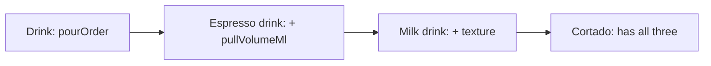

# What is slot inheritance?

## In short

When you attach a slot to a kind of thing, every kind below it gets that slot too, so you only write it once.



Say every drink on the Vertex Coffee menu needs a pour order. You could add the slot to Cortado, Latte, Mocha and 20 more. Or you add it once to Drink. Every kind below Drink then has it, and a new kind you add next week has it too.

## See it

This is part of the [espresso tutorial](../../examples/espresso/tutorial/0-intro.md) ontology. Vertex Coffee is a made-up café, and Cortado is one of its drinks. A ring is a kind of thing. The arrows between rings read "is a kind of". Slots are switched on, so you can see which ring each one hangs from.

<okb-graph src="/data/espresso.json" focus="Cortado, Drink" highlight="Cortado" show="Slot" label="The chain from Drink down to Cortado, with the slots attached along the way">
<p>The graph shows the chain of kinds from Drink down to Cortado.</p>
<ul>
<li>Cortado is a kind of Milk drink. Milk drink is a kind of Espresso drink. Espresso drink is a kind of Drink.</li>
<li>Drink has the slots <code>pourOrder</code>, <code>origin</code>, <code>contains</code> and <code>variationOf</code>.</li>
<li>Espresso drink adds <code>pullVolumeMl</code>. Milk drink adds <code>texture</code> and <code>espressoToMilkRatio</code>.</li>
<li>Cortado has no slots of its own. It gets every slot above it.</li>
</ul>
</okb-graph>

Notice where each slot sits. Each one is attached at the highest kind that can have it. A pull volume only makes sense for a drink with espresso in it, so it hangs from Espresso drink and not from Drink. A milk-only texture hangs from Milk drink. That is the rule of thumb: attach a slot as high as it's true for every kind below, and no higher. The word for what Cortado does is [inheritance](../GLOSSARY.md#concept-inheritance).

## In okb

Run [`okb show`](../CLI.md#cmd-show) on Cortado, from the `espresso` folder.

```bash
okb show Cortado
```

```text
Cortado  Class · c.cortado
  Espresso cut with an equal amount of warm milk.
  parents        MilkDrink
  subclasses     —

  Slots  (properties hold values; relationships → link to other things)
    espressoToMilkRatio Float, single (from MilkDrink)
                       fixed = 1
    texture            Enumerated, {silky, foamy, thick}, single (from MilkDrink)
    pullVolumeMl       Integer, single (from EspressoDrink)
    pourOrder          String, single (from Drink)
    origin             String, single (from Drink)
                       fixed = Spain
    contains           Instance, → Ingredient (:CONTAINS), multiple, min 1, inverse of usedIn (from Drink)
    variationOf        Instance, → Drink (:VARIATION_OF), multiple (from Drink)
  instances      Vertex cortado

  Design decisions
    d.5: Cortado is a class. Every drink type, Cortado included, is a class. Items on the menu
    are instances.
```

Cortado has no slots attached directly. Every line says where it came from: `from MilkDrink`, `from EspressoDrink` or `from Drink`. The `fixed` lines are values that Cortado sets for the whole kind.

> **Common mistakes**
>
> - **Repeating a slot on every kind.** If you attach `pourOrder` to each drink, one rename means 20 edits.
> - **Attaching too high.** A `texture` slot on Drink would also show up for a plain Espresso, which has no milk.
> - **Attaching too low.** A slot on Cortado alone is invisible to Latte, which needs it too.

## Related pages

- [The espresso tutorial, step 5](../../examples/espresso/tutorial/5-slots.md) attaches these slots to the hierarchy.
- [Where to attach a slot](../DECISIONS.md#decision-slot-placement) walks through the choice.
- [What is a knowledge graph?](knowledge-graphs.md) introduces the kinds and "is a" links used here.
- [Glossary](../GLOSSARY.md) defines every term used here.

## Sources

[_Ontology Development 101_](https://protege.stanford.edu/publications/ontology_development/ontology101.pdf) by Noy and McGuinness (PDF), page 9: "All subclasses of a class inherit the slot of that class."
