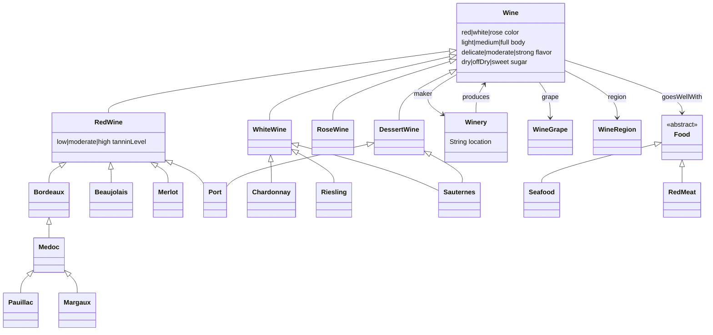

<!-- Generated by `npm run example` from tutorial-src/8-review.md. Don't edit this file: edit the source and rebuild. -->

# Step 8: Review

## Introduction

Check the ontology against the questions you wrote in step 1, and run every check.

An ontology is only good if it does its job. This step is where you find out, and where you decide what to change. You can read the full guide to this step in [Methodology](../../../docs/METHOD.md#step-8-review).

## What you'll make

Every [competency question](../../../docs/GLOSSARY.md#concept-competency-question) linked to the [classes](../../../docs/GLOSSARY.md#concept-class) and [slots](../../../docs/GLOSSARY.md#concept-slot) that answer it, a clean `validate --all`, and a short list of hints you decide about.

## Run the commands

Link each competency question to the parts of the model that answer it. The first number is the question's number from step 1:

```bash
okb cq link 1 color body flavor sugar tanninLevel
okb cq link 2 Bordeaux RedWine WhiteWine
okb cq link 3 goesWellWith grape Seafood
okb cq link 4 RedMeat goesWellWith
okb cq link 5 goesWellWith body flavor
okb cq link 6 produces Winery
```

```text
Linked cq.1 → color (Slot).
Linked cq.1 → body (Slot).
Linked cq.1 → flavor (Slot).
Linked cq.1 → sugar (Slot).
Linked cq.1 → tanninLevel (Slot).
  Tip: cq.1 is one example of a family of questions. Would you also ask more about Wine (maker, grape, region, goesWellWith)? Add the ones you want (okb cq add "..."), note the rest as out of scope (okb scope --out-of-scope "..."), or keep it narrow.

Linked cq.2 → Bordeaux (Class).
Linked cq.2 → RedWine (Class).
Linked cq.2 → WhiteWine (Class).
  Tip: cq.2 is one example of a family of questions. Would you also ask the same question about Beaujolais, Merlot, Port, Medoc, or more about Bordeaux (maker, grape, region, goesWellWith); the same question about RoseWine, DessertWine? Add the ones you want (okb cq add "..."), note the rest as out of scope (okb scope --out-of-scope "..."), or keep it narrow.

Linked cq.3 → goesWellWith (Slot).
Linked cq.3 → grape (Slot).
Linked cq.3 → Seafood (Class).
  Tip: cq.3 is one example of a family of questions. Would you also ask more about Wine (maker, region); the same question about RedMeat? Add the ones you want (okb cq add "..."), note the rest as out of scope (okb scope --out-of-scope "..."), or keep it narrow.

Linked cq.4 → RedMeat (Class).
Linked cq.4 → goesWellWith (Slot).
  Tip: cq.4 is one example of a family of questions. Would you also ask more about Wine (maker, region)? Add the ones you want (okb cq add "..."), note the rest as out of scope (okb scope --out-of-scope "..."), or keep it narrow.

Linked cq.5 → goesWellWith (Slot).
Linked cq.5 → body (Slot).
Linked cq.5 → flavor (Slot).
  Tip: cq.5 is one example of a family of questions. Would you also ask more about Wine (maker, region)? Add the ones you want (okb cq add "..."), note the rest as out of scope (okb scope --out-of-scope "..."), or keep it narrow.

Linked cq.6 → produces (Slot).
Linked cq.6 → Winery (Class).
  Tip: cq.6 is one example of a family of questions. Would you also ask more about Winery (location)? Add the ones you want (okb cq add "..."), note the rest as out of scope (okb scope --out-of-scope "..."), or keep it narrow.
```

See the whole list:

```bash
okb cq list
```

```text
cq.1   Which wine characteristics should I consider when choosing a wine? [draft]
       needs: color, body, flavor, sugar, tanninLevel
cq.2   Is Bordeaux a red or white wine? [draft]
       needs: Bordeaux, RedWine, WhiteWine
cq.3   Does Cabernet Sauvignon go well with seafood? [draft]
       needs: goesWellWith, grape, Seafood
cq.4   What is the best choice of wine for grilled meat? [draft]
       needs: RedMeat, goesWellWith
cq.5   Which characteristics of a wine affect its appropriateness for a dish? [draft]
       needs: goesWellWith, body, flavor
cq.6   Which wines does a given winery produce? [draft]
       needs: produces, Winery
```

Then run every check, including the ones hidden until now:

```bash
okb validate --all
```

```text
✗ 0 error(s)   ! 0 warning(s)   i 4 hint(s)   · all checks

HINTS: worth a look
  i The subclasses of 'RedWine' ('Bordeaux', 'Beaujolais', 'Merlot', 'Port') have no disjointness declared. Can anything be more than one of them? [disjoint-consider-siblings]
      Fix: `okb class disjoint A B C`, or ignore it if the siblings can overlap (Dessert Wine
      and White Wine can).
  i The subclasses of 'Medoc' ('Pauillac', 'Margaux') have no disjointness declared. Can anything be more than one of them? [disjoint-consider-siblings]
      Fix: `okb class disjoint A B C`, or ignore it if the siblings can overlap (Dessert Wine
      and White Wine can).
  i No competency question needs these classes (or their parent/child): 'WineRegion'. [scope-no-unneeded]
      Fix: Link it to (or add) the question that needs it, or remove it.
  i No competency question needs these slots: 'region', 'location'. [scope-no-unneeded]
      Fix: Link it to (or add) the question that needs it, or remove it.

EXPLAINED by design decisions (2)
  · Class 'Sauternes' looks plural, but the convention is singular. Try 'Sauterne'. [naming-singular-plural-consistent] → d.2
  · 'Bordeaux' has only one direct subclass ('Medoc'). Is a sibling missing, or is the subclass really the same as its parent? [hier-single-child] → d.3

Learn about any rule: okb explain <rule-id>   ·   add --why for reasons and sources
```

## Read the output

- **The tips after `cq link`.** okb suggests related questions. If you ask about one wine's characteristics, you may also want them for white wines.
- **No errors.** An error means something is wrong. okb found none, so the ontology is valid.
- **Four hints, left on purpose.** `WineRegion`, `region` and `location` aren't needed by any question. Either add a question like "Where does this wine come from?", or remove them.
- **Two groups with no [disjoint](../../../docs/GLOSSARY.md#concept-disjoint) declaration.** This is worth a real conversation. A Bordeaux blend usually contains Merlot grapes. Are the classes Merlot and Bordeaux disjoint, then? It depends on whether Merlot means "varietal Merlot wine". Record your answer as a [design decision](../../../docs/GLOSSARY.md#concept-design-decision).

## Check your work

```bash
okb status
```

```text
Wine and Food  · 21 classes · 11 slots · 9 instances · 6 questions

✓ 1. Determine the domain and scope
✓ 2. Consider reusing existing ontologies
✓ 3. Enumerate important terms
✓ 4. Define the classes and the class hierarchy
✓ 5. Define the properties of classes (slots)
✓ 6. Define the facets of the slots
✓ 7. Create instances
✓ 8. Review against your questions, and iterate ◀ you are here
     ✓ Every competency question is linked to what answers it
     ? Each question's family has been considered: wanted questions added, the rest recorded as out of scope
     ✓ No errors from okb validate
     ✓ Every remaining warning is fixed or explained in a design decision
     ? Someone who knows the domain has looked at it

Validator (steps 1–8): ✗ 0  ! 0  i 4   okb validate for details

See the guide for this step: okb step
```

All eight steps have a tick. The two items marked `?` need a person: someone who knows wine should look at the tree, and you should decide which related questions to add. okb can't do that for you.

## Draw and export

Make a diagram of the classes and how they connect. Use `--out` to write it to a file, `diagram.md`, in your current folder. That's `wine`, so the file sits next to `okb.json`:

```bash
okb diagram --out diagram.md
```

```text
Wrote diagram.md. Open it in GitHub, VS Code (Markdown preview), or mermaid.live.
```

okb wrote the diagram to `diagram.md` in Mermaid, a text format that GitHub and many Markdown previews draw for you. Here it is, drawn:



Disjoint: RedWine ⟂ WhiteWine · RedWine ⟂ RoseWine · WhiteWine ⟂ RoseWine · Chardonnay ⟂ Riesling · Seafood ⟂ RedMeat

A graph database wants the data the other way round: each [instance](../../../docs/GLOSSARY.md#concept-instance) becomes a node labeled with its class and all its parents. Write that out as Cypher and as JSON:

```bash
okb export --format cypher --out wine.cypher
okb export --with-schema --out wine-export.json
```

```text
Wrote wine.cypher: 9 nodes, 5 relationships (cypher).
  2 class-level relationship value(s) point at classes (e.g. RedWine GOES_WELL_WITH RedMeat), not instances, so they're only exported with --with-schema.
  Inverse relationships are stored once: produces = MAKER followed backwards.

Wrote wine-export.json: 30 nodes, 37 relationships (json).
  Inverse relationships are stored once: produces = MAKER followed backwards.
```

> **Common mistakes**
>
> - **Treating hints as errors.** A hint is a prompt to think. You can accept it and move on.
> - **Linking a question to everything.** Link only what's needed to answer it. The unused-part hint depends on this.
> - **Stopping at "no errors".** A valid ontology can still miss the point. Ask whether you could answer each question from it.

## Next step

You built a complete, valid ontology and exported it. To build one for your own subject, start again at [Step 1](1-scope.md) with your own domain, or ask Claude to coach you through it.

If you'd like more practice first, try the [espresso tutorial](../../espresso/tutorial/0-intro.md). It builds a small ontology of coffee drinks in the same eight steps, and it adds a class with two parents, rules from a document, and a warning you decide about.
